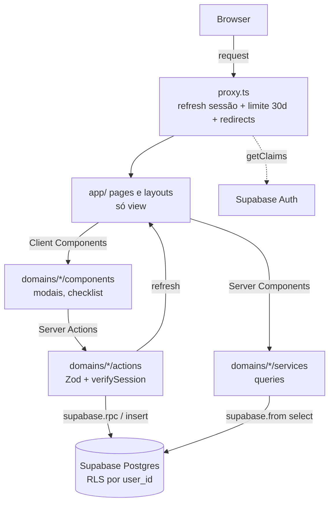
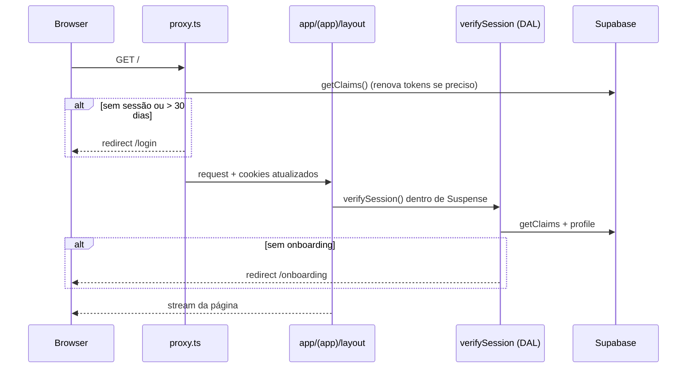
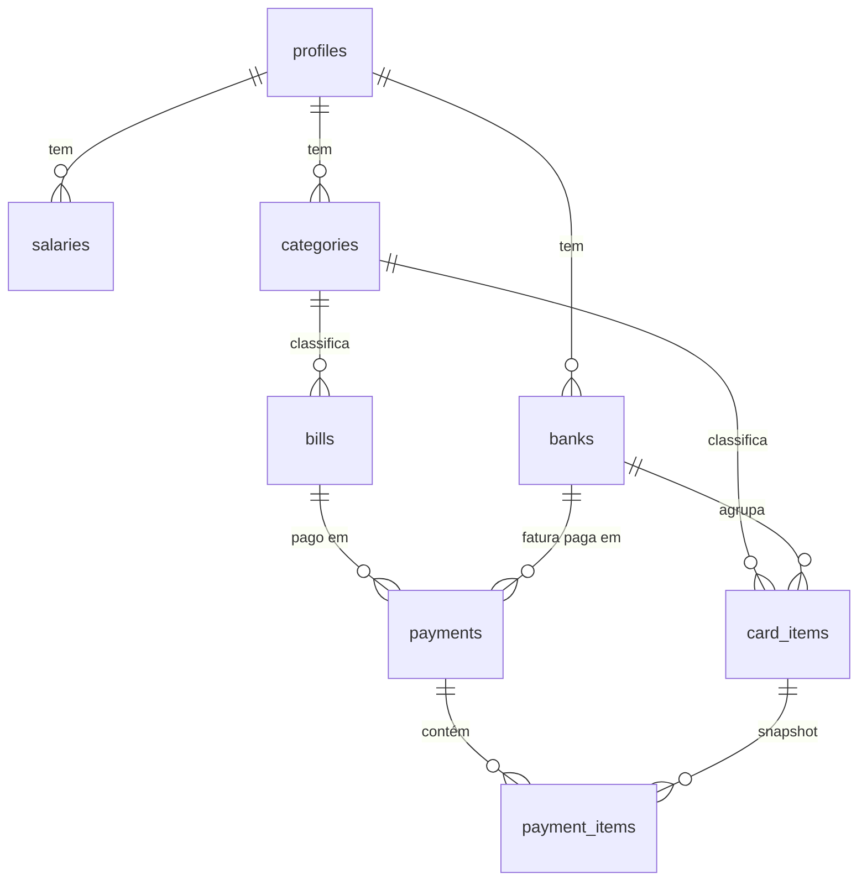

# MVP Contas em Dia Design

**Spec**: `.specs/features/mvp-contas-em-dia/spec.md`
**Context**: `.specs/features/mvp-contas-em-dia/context.md`
**Status**: Draft

---

## 1. Layout das telas (wireframes)

Mobile-first (375px). Desktop: bottom nav vira sidebar à esquerda; conteúdo da Início em grid de 2 colunas (ver 1.12).

### 1.1 Login (`/login`)

```
┌─────────────────────────────┐
│                             │
│        Contas em Dia        │
│                             │
│  Email                      │
│  ┌───────────────────────┐  │
│  │                       │  │
│  └───────────────────────┘  │
│  Senha                      │
│  ┌───────────────────────┐  │
│  │                    👁  │  │
│  └───────────────────────┘  │
│  ⚠ Email ou senha inválidos │
│                             │
│  ┌───────────────────────┐  │
│  │        Entrar         │  │
│  └───────────────────────┘  │
│                             │
│   Não tem conta? Cadastre-se│
└─────────────────────────────┘
```

### 1.2 Cadastro (`/cadastro`)

Mesmo layout do login: Email, Senha, Confirmar senha, botão **Criar conta**, link "Já tem conta? Entrar". Sem nav.

### 1.3 Onboarding (`/onboarding`)

```
┌─────────────────────────────┐
│  Bem-vindo! 👋               │
│  Vamos configurar sua conta │
│                             │
│  Como podemos te chamar?    │
│  ┌───────────────────────┐  │
│  │ Igor                  │  │
│  └───────────────────────┘  │
│  Salário líquido mensal     │
│  ┌───────────────────────┐  │
│  │ R$ 5.000,00           │  │
│  └───────────────────────┘  │
│  Vale a partir deste mês.   │
│                             │
│  ┌───────────────────────┐  │
│  │       Começar         │  │
│  └───────────────────────┘  │
└─────────────────────────────┘
```

### 1.4 Início (`/`)

```
┌─────────────────────────────┐
│ Olá, Igor        Nov/2026   │
├─────────────────────────────┤
│ ┌───────────┐ ┌───────────┐ │
│ │ Salário ✏ │ │ Sobra     │ │
│ │R$ 5.000,00│ │R$ 3.270,00│ │  ← sobra negativa: vermelho
│ └───────────┘ └───────────┘ │
│                             │
│ ┌─────────────────────────┐ │
│ │ + Adicionar pagamento   │ │  ← botão primário
│ └─────────────────────────┘ │
│                             │
│ Pagamentos do mês           │
│ ┌─────────────────────────┐ │
│ │ ○ Nubank        ▾       │ │  ← não pago, expansível
│ │   R$ 480,00  Não pago   │ │
│ │ ├ Netflix     R$ 55,90  │ │
│ │ ├ Spotify     R$ 21,90  │ │
│ │ └ Notebook 3x R$ 402,20 │ │
│ ├─────────────────────────┤ │
│ │ ○ Energia               │ │
│ │   Valor variável Não pago│ │
│ ├─────────────────────────┤ │
│ │ ● Internet         ↶    │ │  ← pago; ↶ = desfazer
│ │   R$ 120,00     Pago ✓  │ │
│ ├─────────────────────────┤ │
│ │ ● Itaú         ▾   ↶    │ │
│ │   R$ 1.610,00   Pago ✓  │ │
│ └─────────────────────────┘ │
│                             │
│ Gastos em 2026              │
│ ┌─────────────────────────┐ │
│ │      ▇                  │ │
│ │ ▇ ▇  ▇ ▇ ▇ ▇ ▇ ▇ ▇ ▇    │ │
│ │ J F  M A M J J A S O N D│ │  ← meses futuros vazios
│ └─────────────────────────┘ │
│                             │
│ Cartões neste mês           │
│ ┌─────────────────────────┐ │
│ │ Itaú   ▇▇▇▇▇▇▇▇ 1.610   │ │
│ │ Nubank ▇▇ —             │ │
│ └─────────────────────────┘ │
├─────────────────────────────┤
│  🏠 Início  🔁 Recorr.  ⚙ Config │  ← bottom nav
└─────────────────────────────┘
```

Estado vazio (sem recorrências):

```
│ Pagamentos do mês           │
│ ┌─────────────────────────┐ │
│ │ Nenhuma conta cadastrada│ │
│ │ [Cadastrar recorrências]│ │  → /recorrencias
│ └─────────────────────────┘ │
```

### 1.5 Modal — Adicionar pagamento (Boleto)

```
┌─────────────────────────────┐
│ Adicionar pagamento      ✕  │
├─────────────────────────────┤
│ Tipo de pagamento           │
│ [ Boleto               ▾ ]  │
│                             │
│ Boleto                      │
│ [ Energia              ▾ ]  │  ← só não pagos no mês
│                             │
│ Valor pago neste mês        │  ← só se variável
│ [ R$ 187,45             ]   │
├─────────────────────────────┤
│ Total: R$ 187,45 [Confirmar]│  ← fixo: só o texto, sem campo
└─────────────────────────────┘
```

### 1.6 Modal — Adicionar pagamento (Cartão)

```
┌─────────────────────────────┐
│ Adicionar pagamento      ✕  │
├─────────────────────────────┤
│ Tipo de pagamento           │
│ [ Cartão de crédito    ▾ ]  │
│ Banco                       │
│ [ Nubank               ▾ ]  │
│                             │
│ Itens da fatura             │
│ ☑ Netflix     55,90   ⏸ 🗑  │  ← recorrente
│ ☐ Spotify     21,90   ⏸ 🗑  │  ← desmarcado só este mês
│ ☐ Disney+ ⏸pausado 33,90 🗑 │  ← pausado (marcar = reativa)
│ ☑ Notebook 3x 402,20  🔒    │  ← parcelado: travado
│                             │
├─────────────────────────────┤
│ Total: R$ 458,10 [Confirmar]│  ← soma dos marcados
└─────────────────────────────┘
⏸ = pausar recorrência (aplicado ao confirmar)
🗑 = remover (abre confirmação, ação imediata)
```

### 1.7 Modal — Atualizar salário (2 passos)

```
Passo 1                         Passo 2 (aviso)
┌───────────────────────────┐   ┌───────────────────────────┐
│ Atualizar salário      ✕  │   │ ⚠ Confirmar alteração     │
│ Novo salário líquido      │   │ Salário passará de        │
│ [ R$ 5.500,00          ]  │   │ R$ 5.000,00 → R$ 5.500,00 │
│ Vale de Nov/2026 em diante│   │ a partir de Nov/2026.     │
│        [Cancelar][Salvar] │ → │      [Voltar][Confirmar]  │
└───────────────────────────┘   └───────────────────────────┘
Com pagamento no mês: ✏ desabilitado + texto
"Desfaça os pagamentos do mês para alterar o salário."
```

### 1.8 Modal — Desfazer pagamento

```
┌───────────────────────────┐
│ Desfazer pagamento?       │
│ Itaú — R$ 1.610,00        │
│ Parcelas voltarão ao valor│
│ anterior.                 │
│      [Cancelar][Desfazer] │
└───────────────────────────┘
```

### 1.9 Recorrências (`/recorrencias`)

```
┌─────────────────────────────┐
│ Recorrências                │
│ ┌────────────┬────────────┐ │
│ │  Boletos   │   Cartão   │ │  ← abas (?aba=cartao)
│ └────────────┴────────────┘ │
│ ┌─────────────────────────┐ │
│ │ Internet     Fixo       │ │
│ │ Internet · R$ 120,00  ⋮ │ │  ← ⋮ = editar / remover
│ ├─────────────────────────┤ │
│ │ Energia      Variável   │ │
│ │ Energia             ⋮   │ │
│ └─────────────────────────┘ │
│                        ( + )│  ← FAB abre modal cadastro
├─────────────────────────────┤
│  🏠 Início  🔁 Recorr.  ⚙ Config │
└─────────────────────────────┘
```

Aba Cartão: lista agrupada por banco; cada item mostra tipo, valor e badge `Recorrente` | `Pausado` | `3 meses restantes`.

### 1.10 Modais de cadastro (reutilizados para edição)

```
Boleto                          Item de cartão
┌───────────────────────────┐   ┌───────────────────────────┐
│ Novo boleto            ✕  │   │ Novo item do cartão    ✕  │
│ Nome  [ Internet       ]  │   │ Nome  [ Notebook       ]  │
│ Tipo  [ Internet     ▾ ]  │   │ Tipo  [ Eletrônicos  ▾ ]  │
│ Valor                     │   │ Banco [ Nubank       ▾ ]  │
│ (●) Fixo  ( ) Variável    │   │ Valor mensal [R$ 402,20]  │
│ [ R$ 120,00            ]  │   │ [x] Sempre recorrente     │
│   ↑ some se Variável      │   │ Meses restantes [ 3    ]  │
│                           │   │   ↑ só se não recorrente  │
│      [Cancelar][Salvar]   │   │      [Cancelar][Salvar]   │
└───────────────────────────┘   └───────────────────────────┘
Sem tipo/banco cadastrado: aviso + link "Cadastrar tipo/banco".
```

### 1.11 Configurações (`/configuracoes`)

```
┌─────────────────────────────┐
│ Configurações               │
│ ┌─────────────────────────┐ │
│ │ Tipos                 › │ │  → /configuracoes/tipos
│ │ Bancos                › │ │  → /configuracoes/bancos
│ │ Perfil                › │ │  → /configuracoes/perfil
│ └─────────────────────────┘ │
└─────────────────────────────┘
```

Tipos e Bancos: lista simples (nome + ⋮ editar/excluir) + FAB → modal com campo Nome. Excluir em uso → erro inline. Perfil: nome (editável) + botão **Sair**.

### 1.12 Desktop (≥1024px)

```
┌──────────┬──────────────────────────────────────────┐
│ Contas   │ Olá, Igor                      Nov/2026  │
│ em Dia   │ [Salário ✏]  [Sobra]   [+ Adicionar pgto]│
│          │ ┌──────────────────┐ ┌─────────────────┐ │
│ 🏠 Início │ │ Pagamentos do mês│ │ Gastos em 2026  │ │
│ 🔁 Recorr.│ │ (lista)          │ ├─────────────────┤ │
│ ⚙ Config │ │                  │ │ Cartões no mês  │ │
│          │ └──────────────────┘ └─────────────────┘ │
└──────────┴──────────────────────────────────────────┘
```

---

## 2. Architecture Overview

Next 16 App Router, `cacheComponents: true`. `app/` só compõe; regras em `domains/`; Supabase (Postgres + Auth) com RLS. Operações que alteram várias tabelas rodam como funções Postgres (RPC) para serem atômicas.



### Fluxo de request autenticado



### Fluxo — pagar cartão

```mermaid
sequenceDiagram
    participant M as CardPaymentForm (client)
    participant SA as payCardAction
    participant DB as rpc pay_card
    M->>SA: { bankId, items: [{id, included, pause}] }
    SA->>SA: Zod + verifySession
    SA->>DB: pay_card(bank_id, items)
    DB->>DB: valida mês não pago; força parcelados incluídos
    DB->>DB: insere payment + payment_items (snapshot p/ desfazer)
    DB->>DB: pausa/reativa; decrementa parcelas; encerra se 0
    DB-->>SA: ok | erro
    SA->>SA: refresh()
    SA-->>M: { ok } | { error }
```

---

## 3. Estrutura de pastas

```
proxy.ts                         # Next 16 proxy → shared/helpers/supabase/proxy
app/
  (auth)/login/page.tsx
  (auth)/cadastro/page.tsx
  onboarding/page.tsx
  (app)/layout.tsx               # AppShell (nav) + guarda de sessão
  (app)/page.tsx                 # Início
  (app)/recorrencias/page.tsx
  (app)/configuracoes/page.tsx
  (app)/configuracoes/tipos/page.tsx
  (app)/configuracoes/bancos/page.tsx
  (app)/configuracoes/perfil/page.tsx
domains/
  auth/        actions/ components/ schemas/ services/
  profile/     actions/ components/ schemas/ services/   # nome + onboarding
  salary/      actions/ components/ schemas/ services/
  categories/  actions/ components/ schemas/ services/   # "Tipos"
  banks/       actions/ components/ schemas/ services/
  bills/       actions/ components/ schemas/ services/   # boletos
  card-items/  actions/ components/ schemas/ services/
  payments/    actions/ components/ schemas/ services/   # pagamento do mês, lista, desfazer
  dashboard/   components/ services/                     # sobra + dados dos gráficos
shared/
  components/ui/                 # shadcn (dialog, select, checkbox, tabs, button, input, chart…)
  components/                    # AppShell, BottomNav, Sidebar, ConfirmDialog, MoneyInput, MoneyText, EmptyState, FormModal, Fab
  helpers/supabase/              # server.ts, client.ts, proxy.ts
  helpers/session.ts             # verifySession (DAL)
  helpers/action-result.ts       # padrão de retorno das Server Actions
  utils/money.ts                 # centavos ↔ BRL
  utils/month.ts                 # mês corrente (America/Sao_Paulo)
  types/database.ts              # gerado pela Supabase CLI
supabase/
  migrations/*.sql               # tabelas, RLS, funções RPC
```

**Regra entre domínios** (refina CLAUDE.md): domínio pode importar de outro domínio apenas `services/` (queries) e types exportados; nunca `components/` ou `actions/`. A composição de componentes de domínios diferentes acontece em `app/`. `dashboard` consome services de `salary` e `payments`.

---

## 4. Code Reuse Analysis

Projeto recém-criado (create-next-app); não há código de domínio existente.

### Existing Components to Leverage

| Component | Location | How to Use |
| --- | --- | --- |
| Root layout + fontes | `app/layout.tsx` | Manter; adicionar `lang="pt-BR"` |
| Tailwind 4 setup | `app/globals.css`, `next.config.ts` | Base para tokens do shadcn |
| shadcn/ui | `shared/components/ui` (a gerar) | Dialog, Select, Checkbox, Tabs, Button, Input, Badge, Chart |
| Exemplo oficial `with-supabase` | vercel/next.js examples | Referência para `server.ts`, `client.ts`, `proxy.ts` |

### Componentes compartilhados (evitam duplicação)

| Componente | Usado por |
| --- | --- |
| `FormModal` | modais de cadastro (boleto, item, tipo, banco) — cria/edita |
| `ConfirmDialog` | remover recorrência, desfazer pagamento, aviso de salário, excluir tipo/banco |
| `MoneyInput` / `MoneyText` | onboarding, salário, boleto, item cartão, pagamento variável, lista, totais |
| `EmptyState` | lista do mês, gráficos, Recorrências, Tipos, Bancos |
| `Fab` | Recorrências, Tipos, Bancos |
| `SimpleNameCrud` (lista + modal só com nome) | Tipos e Bancos (mesma UI, actions diferentes por props) |

### Integration Points

| System | Integration Method |
| --- | --- |
| Supabase Auth | `@supabase/ssr` 0.12.x — `createServerClient`/`createBrowserClient`, `getClaims()` no servidor |
| Supabase Postgres | `supabase-js` 2.11x — `.from()` para leituras/CRUD simples, `.rpc()` para operações atômicas |
| Supabase CLI 3.x | `supabase migration new`, `supabase db push --remote`, `supabase gen types typescript --remote=<ref>` |

---

## 5. Components

### shared/helpers/supabase

- **Purpose**: Criar clients Supabase por contexto.
- **Interfaces**:
  - `createClient(): Promise<SupabaseClient<Database>>` (server) — cookies via `getAll/setAll`, try/catch no `setAll` (Server Components não setam cookie).
  - `createClient(): SupabaseClient<Database>` (browser) — uso mínimo (nenhuma tela precisa no MVP; ver Tech Decisions).
  - `updateSession(request: NextRequest): Promise<NextResponse>` — chama `getClaims()`, aplica limite 30 dias e redirects.
- **Dependencies**: `@supabase/ssr`, env `NEXT_PUBLIC_SUPABASE_URL`, `NEXT_PUBLIC_SUPABASE_PUBLISHABLE_KEY`.

### shared/helpers/session.ts (DAL)

- **Purpose**: Autorização próxima aos dados.
- **Interfaces**:
  - `verifySession(): Promise<{ userId: string }>` — `cache()` do React + `server-only`; sem sessão → `redirect('/login')`.
  - `requireOnboarded(): Promise<{ userId: string; name: string }>` — sem profile → `redirect('/onboarding')`.
- **Reuses**: padrão DAL da doc Next (`02-guides/authentication.md`).

### shared/helpers/action-result.ts

- **Purpose**: Retorno padronizado de Server Actions.
- **Interfaces**: `type ActionResult<T = void> = { ok: true; data: T } | { ok: false; error: string; fieldErrors?: Record<string, string[]> }`.

### shared/utils

- `money.ts`: `formatBRL(cents: number): string`, `parseBRL(input: string): number | null` (→ centavos).
- `month.ts`: `currentMonth(): string` (`YYYY-MM-01`, fuso `America/Sao_Paulo`), `formatMonth(month: string): string` (`Nov/2026`).

### domains/auth

- **Purpose**: Cadastro, login, logout.
- **Actions**: `signUpAction(formData): ActionResult` · `signInAction(formData): ActionResult` · `signOutAction(): void`.
- **Components**: `SignInForm`, `SignUpForm` (client, `useActionState`).
- **Schemas**: `signInSchema`, `signUpSchema` (email, senha ≥ 8, confirmação).
- **Covers**: AUTH-01..04.

### domains/profile

- **Purpose**: Nome do usuário e onboarding.
- **Actions**: `completeOnboardingAction(formData)` → `rpc('complete_onboarding')` · `updateNameAction(formData)`.
- **Services**: `getProfile(userId): Promise<Profile | null>`.
- **Components**: `OnboardingForm`, `ProfileForm`, `SignOutButton` (usa action de auth via props a partir de `app/`).
- **Covers**: ONB-01, NAV-01 (perfil).

### domains/salary

- **Purpose**: Salário vigente e alteração.
- **Services**: `getSalaryForMonth(userId, month): Promise<number>` (último `effective_month ≤ month`).
- **Actions**: `updateSalaryAction(formData)` → `rpc('update_salary')`.
- **Components**: `SalaryCard` (server) + `UpdateSalaryDialog` (client, 2 passos).
- **Covers**: SAL-01, HOME-01.

### domains/categories / domains/banks

- **Purpose**: CRUD de nome.
- **Services**: `listCategories(userId)`, `listBanks(userId)`.
- **Actions**: `create*/update*/delete*Action` — delete trata erro de FK/uso (ver Error Handling).
- **Components**: consomem `SimpleNameCrud` compartilhado.
- **Covers**: TIPO-01, BANCO-01.

### domains/bills

- **Purpose**: CRUD de boletos recorrentes.
- **Services**: `listActiveBills(userId)`.
- **Actions**: `createBillAction`, `updateBillAction`, `endBillAction` (soft delete `ended_at`).
- **Schemas**: `billSchema` — discriminated union por `valueMode` (`fixed` exige `amountCents > 0`; `variable` sem valor).
- **Components**: `BillList`, `BillFormModal`.
- **Covers**: BOL-01, BOL-02.

### domains/card-items

- **Purpose**: CRUD de itens recorrentes/parcelados do cartão.
- **Services**: `listCardItemsByBank(userId)`, `listOpenItemsForBank(userId, bankId)`.
- **Actions**: `createCardItemAction`, `updateCardItemAction`, `endCardItemAction`.
- **Schemas**: `cardItemSchema` — `alwaysRecurring: true` | `{ alwaysRecurring: false, remainingMonths: int ≥ 1 }`.
- **Components**: `CardItemList` (agrupado por banco), `CardItemFormModal`, `CardItemStatusBadge`.
- **Covers**: CART-01, CART-02.

### domains/payments

- **Purpose**: Pagamento do mês, lista do mês, desfazer.
- **Services**:
  - `getMonthPayables(userId, month): Promise<PayableRow[]>` — monta linhas (boleto/banco), status, valor e ordenação (não-pagos primeiro, valor desc).
  - `getPendingBills(userId, month)`, `getPendingBanks(userId, month)` — opções dos selects.
  - `getPaidTotal(userId, month): Promise<number>`.
  - `getYearTotals(userId, year): Promise<MonthTotal[]>`, `getBankTotals(userId, month): Promise<BankTotal[]>`.
- **Actions**: `payBillAction({ billId, amountCents? })`, `payCardAction({ bankId, items })`, `undoPaymentAction({ paymentId })`.
- **Schemas**: `payBillSchema`, `payCardSchema`.
- **Components**:
  - `AddPaymentDialog` (client) — select Boleto/Cartão, alterna subformulários.
  - `BillPaymentFields` (client) — select boleto + `MoneyInput` condicional.
  - `CardPaymentChecklist` (client) — checklist, pausar, remover (recebe `endCardItemAction` via props de `app/`), total.
  - `PaymentTotalFooter` — total em texto + Confirmar.
  - `MonthPayablesList` (server) + `PayableRow` (client, expandir/desfazer).
- **Covers**: PAG-01..04, HOME-02, UNDO-01.

### domains/dashboard

- **Purpose**: Agregados da Início.
- **Services**: `getMonthSummary(userId, month): Promise<{ salaryCents; paidCents; leftoverCents; hasPayments }>` — usa `salary` + `payments` services.
- **Components**: `LeftoverCard`, `YearSpendingChart` (client, Recharts BarChart vertical), `BankSpendingChart` (client, BarChart horizontal).
- **Covers**: HOME-01, GRAF-01, GRAF-02.

### shared/components (layout)

- `AppShell` — `BottomNav` (< 1024px) / `Sidebar` (≥ 1024px), item ativo via `usePathname` (client só no nav).
- **Covers**: NAV-01.

---

## 6. Data Models

Todos os valores em **centavos** (`integer`). Todas as tabelas com `user_id uuid references auth.users` + RLS `user_id = auth.uid()`. Mês = `date` sempre no dia 1.

```sql
profiles (
  id uuid pk references auth.users,
  name text not null,
  created_at timestamptz default now()
)

salaries (
  id uuid pk,
  user_id uuid not null,
  amount_cents integer not null check (amount_cents > 0),
  effective_month date not null,               -- vale deste mês em diante
  unique (user_id, effective_month)
)

categories (                                    -- "Tipos"
  id uuid pk, user_id uuid not null, name text not null,
  unique (user_id, lower(name))
)

banks (
  id uuid pk, user_id uuid not null, name text not null,
  unique (user_id, lower(name))
)

bills (                                          -- boletos recorrentes
  id uuid pk, user_id uuid not null,
  category_id uuid not null references categories on delete restrict,
  name text not null,
  value_mode text not null check (value_mode in ('fixed','variable')),
  amount_cents integer,                          -- obrigatório se fixed, null se variable
  ended_at timestamptz,                          -- soft delete
  created_at timestamptz default now(),
  check ((value_mode = 'fixed' and amount_cents > 0) or (value_mode = 'variable' and amount_cents is null))
)

card_items (
  id uuid pk, user_id uuid not null,
  bank_id uuid not null references banks on delete restrict,
  category_id uuid not null references categories on delete restrict,
  name text not null,
  amount_cents integer not null check (amount_cents > 0),
  remaining_months integer check (remaining_months >= 0),  -- null = sempre recorrente
  status text not null default 'active' check (status in ('active','paused')),
  ended_at timestamptz,
  created_at timestamptz default now(),
  check (remaining_months is null or status = 'active')     -- parcelado não pausa
)

payments (
  id uuid pk, user_id uuid not null,
  month date not null,
  kind text not null check (kind in ('bill','card')),
  bill_id uuid references bills,
  bank_id uuid references banks,
  total_cents integer not null check (total_cents >= 0),
  created_at timestamptz default now(),
  check ((kind = 'bill' and bill_id is not null and bank_id is null)
      or (kind = 'card' and bank_id is not null and bill_id is null))
)
-- unique parcial: (user_id, month, bill_id) where kind='bill'
--                 (user_id, month, bank_id) where kind='card'

payment_items (                                  -- snapshot do cartão p/ histórico e desfazer
  id uuid pk, payment_id uuid not null references payments on delete cascade,
  card_item_id uuid not null references card_items,
  included boolean not null,
  amount_cents integer not null,
  prev_status text not null,
  prev_remaining_months integer,
  prev_ended_at timestamptz
)
```



### Funções RPC (plpgsql)

- `complete_onboarding`: `security invoker` (RLS aplica).
- Pagamentos (`pay_bill`, `pay_card`, `undo_payment`): **`security definer`** + `search_path = ''`, filtrando por `auth.uid()`. `payments`/`payment_items` só têm `select` para `authenticated` — escrita apenas via RPC (impede inserir pagamento com valor arbitrário pela API). Helpers internos `insert_payment` e `card_selection` sem `execute` para usuários.

| Função | Faz | Valida |
| --- | --- | --- |
| `complete_onboarding(name, amount_cents)` | insere `profiles` + `salaries` (mês atual) | profile ainda não existe |
| `update_salary(amount_cents)` | upsert `salaries` do mês atual | nenhum `payments` no mês atual |
| `pay_bill(bill_id, amount_cents)` | insere `payments` | não pago no mês; fixo → usa valor do cadastro (ignora input); variável → exige > 0 |
| `pay_card(bank_id, items jsonb)` | insere `payments` + `payment_items`; pausa/reativa; decrementa parcelas; `ended_at` quando chega a 0 | banco não pago no mês; parcelados forçados `included`; ≥ 1 incluído; valores lidos do banco, não do cliente |
| `undo_payment(payment_id)` | restaura `prev_*` dos itens; apaga payment | só mês atual |

Mês atual nas funções: `date_trunc('month', now() at time zone 'America/Sao_Paulo')::date`. Mesmo fuso em `shared/utils/month.ts`.

### Types de domínio (derivados, sem redeclarar)

```typescript
// shared/types/database.ts gerado → Tables<'bills'>, Tables<'card_items'>…
type PayableRow =
  | { kind: 'bill'; billId: string; name: string; valueMode: 'fixed' | 'variable'; amountCents: number | null; paid: boolean; paymentId?: string }
  | { kind: 'card'; bankId: string; name: string; amountCents: number; paid: boolean; paymentId?: string; items: { name: string; amountCents: number; remainingMonths: number | null; status: 'active' | 'paused' }[] }
```

**Regras de exibição na lista do mês:**
- Boleto aparece se `ended_at is null` **ou** pago no mês.
- Banco aparece se tem item não encerrado **ou** pagamento no mês.
- Banco pago: valor = `payments.total_cents`, itens = `payment_items` incluídos. Não pago: soma dos itens `active`.

---

## 7. Error Handling Strategy

| Error Scenario | Handling | User Impact |
| --- | --- | --- |
| Validação Zod falha | Action retorna `fieldErrors` | Erro abaixo do campo; modal aberto |
| Email já cadastrado | Mapeia erro do Supabase Auth | "Email já cadastrado" |
| Credenciais inválidas | Mensagem genérica | "Email ou senha inválidos" |
| Pagamento duplicado (2 abas) | unique parcial → RPC lança; action mapeia | "Este pagamento já foi registrado" + lista atualiza |
| Alterar salário com pagamento | RPC lança | Botão já desabilitado; fallback com mensagem |
| Excluir tipo/banco em uso | FK `restrict` (código 23503) → action mapeia | "Tipo em uso por N recorrências" |
| Nome duplicado | unique (23505) → action mapeia | "Já existe um tipo com esse nome" |
| Sessão > 30 dias / refresh inválido | proxy → `signOut` + redirect | Volta ao login |
| Falha de rede / 5xx | `ok: false` genérico | Toast/erro no modal; dados preservados |
| Acesso a dado de outro usuário | RLS retorna vazio / nega | Nada exibido |
| Erro inesperado em Server Component | `error.tsx` no grupo `(app)` | Tela de erro com "Tentar novamente" |

---

## 8. Tech Decisions

| Decision | Choice | Rationale |
| --- | --- | --- |
| Limite de 30 dias | **No proxy da app**, não no Supabase | Time-box de sessão do Supabase é só plano Pro; refresh tokens do Supabase não expiram por padrão. Proxy lê o início da sessão pelos claims (`amr[].timestamp`, estável entre refreshes — verificado); sem `amr` com timestamp = expirado |
| Escritas multi-tabela | Funções Postgres via `rpc()` | supabase-js não tem transação; pagar cartão/desfazer mexem em 3 tabelas |
| Valores do pagamento | Servidor recalcula a partir do cadastro | Cliente não define valor de fixo/cartão; evita manipulação |
| Snapshot em `payment_items` | Guarda `prev_*` | Desfazer exato + histórico imune a edições posteriores |
| Soft delete (`ended_at`) | Recorrências nunca apagadas | Histórico nos gráficos (decisão do interview) |
| Mês corrente | Fuso `America/Sao_Paulo`, calculado no banco nas escritas | Evita divergência perto da meia-noite UTC |
| Cache Components | Leituras de sessão/dados atrás de `<Suspense>`; sem `use cache` no MVP; `refresh()` após actions | `cacheComponents: true` exige Suspense para `cookies()`; dados por usuário mudam a cada ação — cache traz pouco ganho no MVP |
| Sessão no servidor | `getClaims()`, nunca `getSession()` | Recomendação oficial Supabase |
| Proxy | `proxy.ts` (Next 16) — só checagem otimista | Doc Next: autorização real no DAL |
| Client Components | Apenas modais, checklist, `PayableRow`, nav, gráficos | Server Components por padrão (CLAUDE.md) |
| Browser Supabase client | Não usado no MVP | Todas mutações via Server Actions |
| Rotas em PT-BR | `/login`, `/cadastro`, `/recorrencias`, `/configuracoes/*` | Público brasileiro; código em inglês |
| Gráficos | shadcn `chart` (Recharts 3) | Tokens de tema consistentes; Recharts 3 suporta React 19 |

### Dependências a instalar (versões atuais npm, 2026-11-09)

| Pacote | Versão |
| --- | --- |
| `@supabase/supabase-js` | 2.119.x |
| `@supabase/ssr` | 0.12.x |
| `zod` | 4.x (`import { z } from "zod"`) |
| `recharts` + `react-is` | 3.10.x (via `shadcn add chart`) |
| `shadcn` (CLI) | 4.x (`npx shadcn@latest init`) |
| `supabase` (CLI, dev) | 3.x |
| `server-only` | latest |

---

## 9. Pontos para validar na implementação

- [x] Claim `amr[].timestamp` presente e estável entre refreshes (verificado em sessão real).
- [ ] Assinatura atual de `setAll` no `@supabase/ssr` 0.12 (doc menciona headers de cache adicionais).
- [ ] Unique `lower(name)` exige índice único por expressão (`create unique index … (user_id, lower(name))`), não constraint.

---

## Requirement Coverage

| ID | Componente(s) |
| --- | --- |
| AUTH-01..04 | domains/auth, proxy.ts, shared/helpers/session |
| ONB-01 | domains/profile, rpc complete_onboarding |
| TIPO-01 | domains/categories, SimpleNameCrud |
| BANCO-01 | domains/banks, SimpleNameCrud |
| BOL-01..02 | domains/bills |
| CART-01..02 | domains/card-items |
| PAG-01 | payments: BillPaymentFields, rpc pay_bill |
| PAG-02..04 | payments: CardPaymentChecklist, rpc pay_card |
| HOME-01 | dashboard: getMonthSummary, SalaryCard, LeftoverCard |
| HOME-02 | payments: MonthPayablesList, getMonthPayables |
| GRAF-01..02 | dashboard: YearSpendingChart, BankSpendingChart |
| SAL-01 | salary: UpdateSalaryDialog, rpc update_salary |
| NAV-01 | shared: AppShell, BottomNav, Sidebar |
| UNDO-01 | payments: PayableRow, rpc undo_payment |

22/22 requisitos cobertos.
