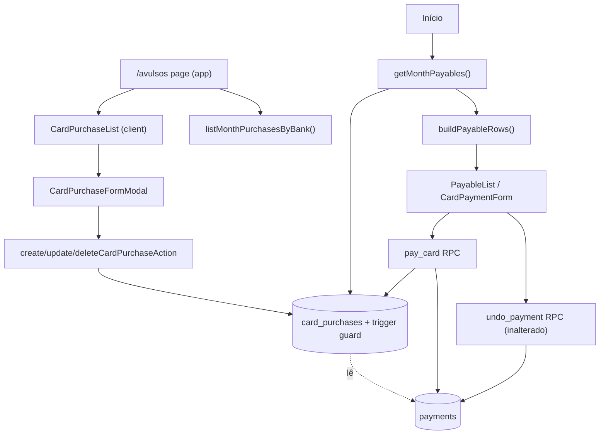

# Compras avulsas no cartão Design

**Spec**: `.specs/features/one-off-card-purchases/spec.md`
**Context**: `.specs/features/one-off-card-purchases/context.md`
**Status**: Approved

---

## Architecture Overview

Novo domínio `card-purchases` (CRUD do mês) + extensão do fluxo de fatura em `payments`. Escrita direta na tabela (padrão de `card_items`), com **trigger** aplicando mês automático e bloqueio de fatura paga no banco. `pay_card` passa a somar os avulsos. Sem snapshot de avulsos: enquanto a fatura está paga, o trigger impede qualquer mudança, então os avulsos do banco/mês **são** o snapshot.



---

## Code Reuse Analysis

### Existing Components to Leverage

| Component | Location | How to Use |
| --- | --- | --- |
| `cardItemSchema` fields (`name`, `categoryId`, `bankId`, `amount`) | `domains/card-items/schemas/card-item.ts` | Copiar o padrão (não importar — domínio não importa outro domínio) |
| `moneyField` | `shared/utils/money.ts` | Valor → centavos > 0 |
| `fromZodError`, `mutationResult`, `isRecordId`, `INVALID_RECORD` | `shared/helpers/*` | Actions |
| `useRecordDialogs` | `shared/hooks/use-record-dialogs.ts` | Abrir form/confirmar exclusão |
| `FormModal`, `FormField`, `MoneyInput`, `SelectField`, `SetupRequired` | `shared/components/*` | Modal de cadastro (mesma composição de `CardItemFormModal`) |
| `RecordActions`, `ConfirmDialog`, `EmptyState`, `Fab`, `MoneyText`, `PageHeader` | `shared/components/*` | Lista |
| `listBanks`, `listCategories` | `domains/banks/services`, `domains/categories/services` | Opções do form (page compõe, como em `/recorrencias`) |
| `currentMonth`, `formatMonth` | `shared/utils/month.ts` | Filtro e cabeçalho |
| `public.current_month()` | migration `profiles_salaries` | Mês no trigger e no `pay_card` |
| Padrão de item travado (cadeado) | `CardPaymentForm.ChecklistItem` | Avulso travado |
| `mapDbError` P0001 | `shared/helpers/action-result.ts` | Mensagem do trigger chega ao usuário sem mapeamento novo |

### Integration Points

| System | Integration Method |
| --- | --- |
| `getMonthPayables` | +1 query paralela em `card_purchases` do mês |
| `buildPayableRows` | Nova fonte `cardPurchases`; itens com `purchase: true` |
| `pay_card` | `create or replace`: soma avulsos do banco/mês; conta como item incluído |
| `undo_payment` | **Sem mudança** (avulsos reabrem porque o trigger deixa de achar o pagamento) |
| `AppNav` | Novo item; bottom nav `grid-cols-4` |
| Sobra / gráficos | Sem mudança (derivam de `payments.total_cents`) |
| Exclusão de banco/tipo | FK `restrict` → `23503` → mensagem existente |

---

## Data Models

### Tabela `public.card_purchases` (migration nova)

```sql
create table public.card_purchases (
  id uuid primary key default gen_random_uuid(),
  user_id uuid not null default auth.uid() references auth.users on delete cascade,
  month date not null default public.current_month() check (extract(day from month) = 1),
  bank_id uuid not null,
  category_id uuid not null,
  name text not null check (length(trim(name)) > 0 and length(name) <= 100),
  amount_cents integer not null check (amount_cents > 0),
  created_at timestamptz not null default now(),
  constraint card_purchases_bank_fkey foreign key (bank_id, user_id)
    references public.banks (id, user_id) on delete restrict,
  constraint card_purchases_category_fkey foreign key (category_id, user_id)
    references public.categories (id, user_id) on delete restrict
);

create index card_purchases_user_month_bank_idx on public.card_purchases (user_id, month, bank_id);

-- RLS: select/insert/update/delete own (padrão card_items, + delete)
grant select, insert, update, delete on public.card_purchases to authenticated;
```

### Trigger `card_purchases_guard` (before insert/update/delete, `security definer`, `search_path = ''`)

1. **INSERT:** `new.month := current_month()` (ignora mês enviado).
2. **UPDATE:** `new.month := old.month`; `new.user_id := old.user_id`.
3. **UPDATE/DELETE** em `old.month <> current_month()` → `raise 'Só é possível alterar avulsos do mês atual.'`
4. Para cada banco afetado (`new.bank_id` em insert/update; `old.bank_id` em update/delete):
   - `select name from banks where id = … for share` (serializa com `pay_card`, que trava o banco `for update`);
   - se existe `payments` `kind = 'card'`, mesmo `user_id`, `bank_id`, `month = current_month()` → `raise format('A fatura do %s deste mês já foi paga. Desfaça o pagamento na Início para alterar.', bank_name)`.
5. Retorna `new` (insert/update) / `old` (delete).

### `pay_card` (create or replace)

- `select … from banks where id = p_bank_id and user_id = v_user_id for update` (troca o `exists` atual; trava contra insert concorrente de avulso).
- `v_purchases_total`, `v_purchases_count` = soma/contagem de `card_purchases` (`user_id`, `bank_id`, `month = current_month()`).
- `if v_included_count + v_purchases_count = 0 then raise 'Selecione ao menos um item.'`
- `insert_payment(..., v_total + v_purchases_total)`; resto inalterado.

### TypeScript

```typescript
// domains/card-purchases/schemas/card-purchase.ts
export const cardPurchaseSchema = z.object({
  name: z.string().trim().min(1, "Informe a descrição").max(100, "Use no máximo 100 caracteres"),
  categoryId: z.uuid("Selecione um tipo"),
  bankId: z.uuid("Selecione um banco"),
  amount: moneyField,
});
export const cardPurchaseUpdateSchema = cardPurchaseSchema.extend({ id: z.uuid() });

// domains/payments/services/build-payable-rows.ts
type CardPurchaseSource = { id: string; name: string; bank_id: string; amount_cents: number };
export type PayableSources = { /* … */ cardPurchases: CardPurchaseSource[] };
export type PayableItem = { /* … */ purchase: boolean }; // true = avulso
```

`payments.total_cents` continua sendo o total pago (recorrentes incluídos + avulsos).

---

## Components

### `card_purchases` migration
- **Purpose**: tabela, RLS, trigger guard, novo `pay_card`.
- **Location**: `supabase/migrations/<timestamp>_card_purchases.sql`
- **Reuses**: FKs compostas, `current_month()`, padrão `security definer` + `search_path = ''`.
- Depois: `npm run db:types`.

### `domains/card-purchases/schemas/card-purchase.ts`
- **Purpose**: validação do form (create/update).
- **Interfaces**: `cardPurchaseSchema`, `cardPurchaseUpdateSchema`.

### `domains/card-purchases/actions/card-purchases.ts` (`"use server"`)
- `createCardPurchaseAction(_state, formData): Promise<ActionResult>` — insert.
- `updateCardPurchaseAction(_state, formData): Promise<ActionResult>` — update por id.
- `deleteCardPurchaseAction(id: string): Promise<ActionResult>` — delete por id.
- Todas: Zod/`isRecordId` → `verifySession` → supabase → `mutationResult` (trigger P0001 → mensagem + refresh).

### `domains/card-purchases/services/card-purchases.ts` (`server-only`)
- `listMonthPurchasesByBank(): Promise<CardPurchaseGroup[]>` — avulsos de `currentMonth()` com `category`/`bank`, agrupados por banco (bancos por nome, itens por nome), cada grupo `{ bank, items, subtotalCents, invoicePaid }`. `invoicePaid` via query paralela em `payments` (`kind = 'card'`, mês corrente).
- **Reuses**: padrão `listCardItemsByBank` (`Map.groupBy`).

### `domains/card-purchases/components/CardPurchaseList.tsx` (client)
- Grupos por banco: título + subtotal + badge "Fatura paga"; itens com tipo e valor; `RecordActions` só se `!invoicePaid`.
- `EmptyState` ("Nenhuma compra avulsa neste mês."), `Fab` ("Nova compra avulsa"), `ConfirmDialog` de exclusão.
- **Reuses**: estrutura de `CardItemList`.

### `domains/card-purchases/components/CardPurchaseFormModal.tsx` (client)
- Campos Descrição, Banco, Tipo, Valor; `SetupRequired` se faltar banco ou tipo.
- **Reuses**: composição de `CardItemFormModal` (sem a parte de recorrência).

### `app/(app)/avulsos/page.tsx`
- `PageHeader title="Avulsos" aside={formatMonth(currentMonth())}` + `Suspense` com `listMonthPurchasesByBank`, `listBanks`, `listCategories` em `Promise.all` → `CardPurchaseList`.

### `shared/components/AppNav.tsx`
- `NAV_ITEMS` += `{ href: "/avulsos", label: "Avulsos", Icon: ShoppingBagIcon }` antes de Configurações; bottom nav `grid-cols-4`.

### `domains/payments` (alterações)
- `services/payables.ts`: query `card_purchases` (`id, name, bank_id, amount_cents`, `month = currentMonth()`).
- `services/build-payable-rows.ts`:
  - `toCardRows`: avulsos do banco (por nome) **após** os itens recorrentes; total não pago soma avulsos; banco gera linha se tiver itens abertos **ou** avulsos; fatura paga lista snapshot + avulsos do banco (`purchase: true`).
  - Itens de `card_items` recebem `purchase: false`.
- `schemas/payment.ts`: remover o `refine` "Selecione ao menos um item." de `payCardSchema` (banco só com avulsos envia `items: []`); regra passa a ser só do `pay_card`. Ajustar o teste unitário correspondente.
- `components/CardPaymentForm.tsx`: `locked = installment || purchase`; avulso: `included: true`, cadeado com `aria-label="Avulso"` + badge "Avulso"; no submit, enviar só itens `!purchase`.
- `components/PayableList.tsx` (`CardItems`): badge "Avulso" quando `item.purchase`.

---

## Error Handling Strategy

| Error Scenario | Handling | User Impact |
| --- | --- | --- |
| Campo inválido | Zod → `fromZodError` | Erro no campo, modal aberto |
| Escrita em banco com fatura paga | Trigger `raise` (P0001) → `mutationResult` refresh | Mensagem "A fatura do {banco} deste mês já foi paga…"; página atualiza e mostra "Fatura paga" |
| Escrita em avulso de mês passado (API direta) | Trigger `raise` | "Só é possível alterar avulsos do mês atual." |
| Banco/tipo excluído com avulso | FK restrict `23503` | "Este registro está em uso e não pode ser excluído." |
| Fatura sem itens nem avulsos | `pay_card` raise | "Selecione ao menos um item." (UI já desabilita com total 0) |
| Avulso criado em outra aba durante checklist | `pay_card` lê avulsos do banco + lock | Total pago inclui o avulso novo; tela atualiza após pagar |
| Pagamento duplicado | Índice único existente | "Este pagamento já foi registrado." |
| Id inválido | `isRecordId` | `INVALID_RECORD` |

---

## Tech Decisions

| Decision | Choice | Rationale |
| --- | --- | --- |
| Snapshot de avulsos no pagamento | **Não criar** snapshot; avulsos do banco/mês são imutáveis enquanto a fatura está paga (trigger) | Snapshot existe em `payment_items` porque `card_items` muda após pagar (parcelas, pausa). Avulso não muda → snapshot seria duplicação. `total_cents` guarda o total. SPEC_DEVIATION de PAY-02 AC3 (ver abaixo) |
| Onde aplicar o bloqueio | Trigger na tabela (escrita direta) | Mantém o padrão de actions de `card_items` (insert/update direto) e cobre chamada direta à API; RPC por operação seria 3 funções novas |
| Concorrência pagamento × novo avulso | `pay_card` trava banco `for update`; trigger `for share` | Sem lock, avulso inserido durante o `pay_card` ficaria fora do total com a fatura paga |
| Mês do avulso | Forçado no trigger (`current_month()`), imutável | Cliente não escolhe mês; fuso São Paulo centralizado no banco |
| Exclusão | Hard delete | Avulso aberto do mês corrente não tem histórico a preservar; pago não pode ser excluído |
| `refine` de `payCardSchema` | Removido | Banco só com avulsos tem `items: []`; regra fica no RPC (fonte da verdade) |
| Badge/estado do avulso em `PayableItem` | Campo `purchase: boolean` | Mínimo para badge e trava; `remainingMonths`/`status` ficam `null`/`"active"` |

### SPEC_DEVIATION

- **PAY-02 AC3** ("gravar o valor de cada avulso no snapshot do pagamento"): substituído por imutabilidade garantida no banco. O histórico de valores pagos permanece consultável (`card_purchases` do banco/mês + `payments.total_cents`). **Aprovado pelo usuário (2026-11-10); spec.md atualizado.**

---

## Test Plan

| Camada | Arquivo | Casos |
| --- | --- | --- |
| unit | `domains/card-purchases/schemas/card-purchase.test.ts` | válido (trim, centavos); descrição vazia/>100; sem banco/tipo; valor 0 |
| unit | `domains/payments/services/build-payable-rows.test.ts` | soma avulsos no total; ordem recorrentes→avulsos; banco só com avulsos gera linha; fatura paga lista snapshot + avulsos |
| unit | `domains/payments/schemas/payment.test.ts` | ajustar: `items: []` válido |
| integration | `supabase/tests/card-purchases.int.test.ts` | RLS (A não lê/escreve B); mês forçado no insert e imutável; insert/update/delete/mudar banco bloqueados com fatura paga (mensagem com nome do banco); update de mês passado bloqueado; banco/tipo em uso não exclui |
| integration | `supabase/tests/pay-card.int.test.ts` | total inclui avulsos; banco só com avulsos paga; sem itens nem avulsos falha; undo libera edição |
| e2e | `e2e/card-purchases.spec.ts` | cadastrar → editar → excluir; ver na fatura da Início com badge; pagar com avulso travado; "Fatura paga" em `/avulsos` + mensagem ao adicionar; desfazer → editável |
| e2e | `e2e/nav.spec.ts` | navegar até Avulsos |
